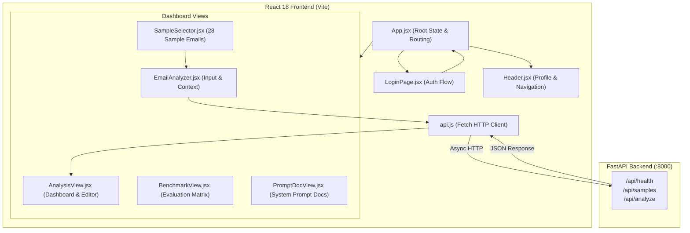

# AI Executive Email Assistant — Frontend Web Client

[](https://react.dev/)
[](https://vitejs.dev/)
[](https://lucide.dev/)

The interactive Single Page Application (SPA) for the **AI Executive Email Assistant**. Built using **React 18**, **Vite 6**, and **Lucide Icons**, this client provides an executive inbox dashboard to configure user context, inspect test emails, review AI-generated analysis, manage action items, and edit context-aware draft replies.

> **Related Repository:** [Backend Service (FastAPI + Gemini)](https://github.com/banrjeesayan/ai-email-assistant-backend)

---

## Client Architecture & End-to-End Flow



---

## UI Components & Screens

| Component File | Role & UI Responsibility |
|---|---|
| **`src/App.jsx`** | Central root component managing global application state: authenticated user session, selected view tab, current email payload, analysis loading states, and error toasts. |
| **`src/components/LoginPage.jsx`** | Demo authentication portal providing credential validation, pre-filled demo accounts, and session initiation. |
| **`src/components/Header.jsx`** | Top navigation bar displaying brand identity, backend connectivity status indicator, active executive profile, and sign-out control. |
| **`src/components/EmailAnalyzer.jsx`** | Two-column input console: left column captures executive context (Name, Role, Tone, Sign-off); right column captures email metadata (Timestamp, Sender, Recipient, Subject, Body) with direct submission trigger. |
| **`src/components/SampleSelector.jsx`** | Interactive drawer showcasing 28 benchmark emails categorized by difficulty (Standard vs. Difficult) and type (complaints, scheduling, phishing, negotiations). Clicking any card instantly populates the analyzer form. |
| **`src/components/AnalysisView.jsx`** | Multi-faceted executive dashboard displaying: 1–3 sentence summary, intent badges, urgency/sentiment level chips, risk warning banners, action items table with owner assignments, resolved deadline schedules, editable draft reply with 1-click clipboard copy, and raw JSON view. |
| **`src/components/BenchmarkView.jsx`** | Evaluation suite interface presenting accuracy metrics across intent, urgency, deadlines, action items, and draft reply quality. |
| **`src/components/PromptDocView.jsx`** | Documentation viewer showing the underlying system prompt, hard extraction constraints, and prompt injection defense rules. |
| **`src/api.js`** | Dedicated HTTP client encapsulating all communication with the backend using the native Fetch API. |

---

## Technologies, Libraries & Tools

| Library / Tool | Version | Role & Specific Responsibility |
|---|---|---|
| **React** | `^18.3.1` | Component-driven UI architecture, reactive state hooks (`useState`, `useEffect`, `useCallback`), and virtual DOM reconciliation. |
| **Vite** | `^6.0.7` | Next-generation frontend build tool providing instantaneous Hot Module Replacement (HMR) and optimized Rollup bundling. |
| **Lucide React** | `^0.469.0` | Modern, lightweight SVG iconography for dashboard metrics, risk alerts, intent tags, copy actions, and navigation. |
| **Vanilla CSS** | Modern CSS3 | Custom design system with glassmorphic cards, responsive flex/grid layouts, dynamic status badges, and smooth hover micro-animations. |
| **Fetch API** | Browser Native | Promise-based asynchronous HTTP requests to communicate with the FastAPI backend. |

---

## Directory Structure

```text
frontend/
|-- src/
|   |-- components/
|   |   |-- AnalysisView.jsx     # Formatted AI dashboard, action items, and draft reply editor
|   |   |-- BenchmarkView.jsx    # Benchmark evaluation UI
|   |   |-- EmailAnalyzer.jsx    # Email input & user context form
|   |   |-- Header.jsx           # Navigation header, backend status & user info
|   |   |-- LoginPage.jsx        # Demo login screen
|   |   |-- PromptDocView.jsx    # System prompt design documentation
|   |   `-- SampleSelector.jsx   # 28-email sample browser
|   |-- api.js                   # API client functions (getHealth, getSamples, analyzeEmail)
|   |-- App.jsx                  # Main application orchestrator & state container
|   |-- index.css                # Global CSS styles, responsive layouts & color tokens
|   `-- main.jsx                 # Application entry point mounting React root
|-- index.html                   # HTML entry point
|-- package.json                 # Project dependencies & scripts
|-- vite.config.js               # Vite build configuration
`-- README.md                    # Frontend documentation
```

---

## Getting Started Locally

### Prerequisites
- **Node.js**: v18.0.0 or higher
- **npm**: v9.0.0 or higher
- **Running Backend**: Ensure the [FastAPI backend](https://github.com/banrjeesayan/ai-email-assistant-backend) is running on `http://localhost:8000`.

### 1. Install Dependencies
```bash
cd frontend
npm install
```

### 2. Start the Development Server
```bash
npm run dev -- --host 0.0.0.0 --port 3000
```

Open your browser at:
```text
http://localhost:3000
```

### 3. Demo Credentials
```text
Username: admin
Password: admin
```

---

## Connecting to the Backend

The frontend communicates with the backend via `src/api.js`. By default, it connects to:

```javascript
const API_URL = "http://localhost:8000/api";
```

### Supported API Actions
1. `getHealth()`: Checks backend status on load to display service health.
2. `getSamples()`: Loads the 28 sample emails into the sample selector drawer.
3. `analyzeEmail(payload)`: Dispatches the email data and user context to Gemini, receiving structured analysis back in real time.

---

## Key User Experience Features

1. **Executive Profile Context:** Injects the user's name, role, desired tone (e.g., *concise*, *diplomatic*, *warm*), and sign-off into the AI prompt so drafted replies match the user's voice.
2. **Instant Sample Selection:** 28 pre-configured emails (spanning executive complaints, urgent vendor escalations, ambiguous requests, and phishing lures) let users test the system immediately without manual typing.
3. **Draft Reply with Placeholder Highlighting:** Any missing facts in the generated draft are formatted with `[CONFIRM: ...]` tags, clearly highlighting fields requiring user attention before sending.
4. **1-Click Copy & Raw Inspection:** Clean one-click copy button for the drafted reply, plus a raw JSON inspector tab for developers and auditors to view the exact Pydantic-validated payload.
